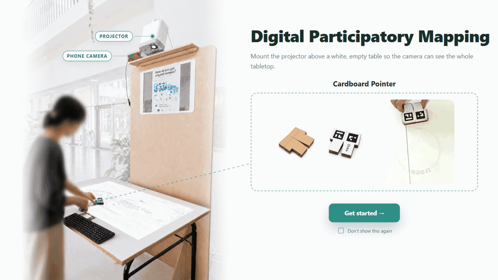
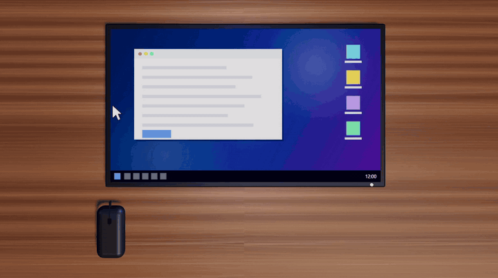
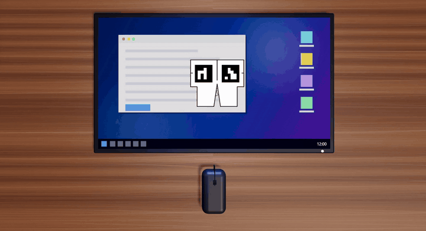

# Low-Barrier Digital Participatory Mapping



This project aims to provide low-cost, easy-to-set-up digital participatory workshops for urban mapping. It uses a video projector, a smartphone camera, and cardboard tokens marked with AprilTags. Participants positioned around the tabletop use these tokens to draw on the map, add comments, and use visualizations tools such as shortest paths and isochrones.

## Setup  

Prebuilt standalone apps are attached to [Releases](../../releases). Unzip
`DigitalMappingWorkshop-windows.zip` and run `DigitalMappingWorkshop.exe`, or
`DigitalMappingWorkshop-macos.zip` and open `DigitalMappingWorkshop.app`. 

## Manual setup

Python 3.11+ recommended.

```
pip install -r requirements.txt
```

```
python app.py --apriltag-family tag16h5
```

Useful arguments:

| Argument | What it does |
|---|---|
| `--source 0` | Camera to use: a webcam index (`0`, `1`, …) or a stream URL. If not provided, the app auto-discovers a phone IP camera on `:8080/video`. |
| `--apriltag-family tag36h11` | Marker family/families to detect (`tag16h5`, `tag25h9`, `tag36h11`, …) and match the tags you printed. Defaults to the marker settings. |
| `--port 5000` | Preferred local port. If it is occupied, the app automatically uses the next available port. Use `--port 0` to let the operating system choose immediately. |

The server prefers http://127.0.0.1:5000 and opens the home page fullscreen in
Chrome or Edge (app mode, no browser chrome; F11 or the on-page ⛶ button toggles
it), or in the default browser when neither is installed. If port 5000 is
already occupied, it automatically selects another available port and opens that
address instead. Without `--source` it looks for an IP camera on port 8080 (e.g. a
phone camera app) and otherwise starts without a camera; you can connect one later
from the Settings page.

## Code layout

| Path | What it holds |
|---|---|
| `app.py` | Starts everything: command-line options, the camera and detector threads, the web server. |
| `backend/` | The server, one module per feature: `camera`, `detection` (AprilTags, `/api/tags`), `surface` (projection corners, set by hand or from a projected tag grid), `marker_settings` + `markers` (tag assignments, printable markers), `street_screen` (the printed street view and map view sheets) + `paper_watch` (photographs each map view sheet whenever no hand is over it — `hands`, MediaPipe — and compares it with the page's blank sheet under the same projection) + `paper_ink` (digitizes the pen lines and points into `sessions/map_view_pages/`), `map_sheets` (+ `map_sheet_layout`, `map_sheet_docx`), `street_network` (routes and walking reach on the saved OSMnx network), `projects` (which project each result belongs to; paper maps and the expo get one), `sessions` (results), `workshops` (projects with their steps, data layers and images), `floorplan`, `recorder`, `pages`. Folder paths are in `backend/config.py`. |
| `web/` | The pages (`home.html`, `index.html` = the map and its Project panel, `marker.html`) and their scripts in `web/src/`. |
| `digitizer/` | The Digitizer for photographed paper sheets, mounted at `/digitizer/`; its sheets are kept in `data/digitized_sheets/`. It can read the handwriting on a map with an optional vision-language model (Qwen3-VL 4B on this computer or 32B on a server; see `digitizer/README.md`). |
| `map-style-editor/maputnik/` | The Maputnik style editor, served prebuilt at `/maputnik/`. |


## Why Apriltag Tokens?

[placeholder for image of different tools]

### Why a pointer and not a mouse?

<table>
  <tr>
    <th>Mouse</th>
    <th>AprilTag pointer</th>
  </tr>
  <tr>
    <td></td>
    <td></td>
  </tr>
</table>

A mouse is a *relative* device: it reports how far it moved, and the cursor
moves by that amount in the screen's own coordinate system. The pointer is an
*absolute* device: the camera sees where the tag is on the table, so the cursor
is simply the tip of the token. That difference matters for two reasons around
a tabletop.

1. **The cursor is at a fixed offset from the token, so it behaves well for drawing.**

2. **A mouse only works for the person sitting in front of the screen.**


